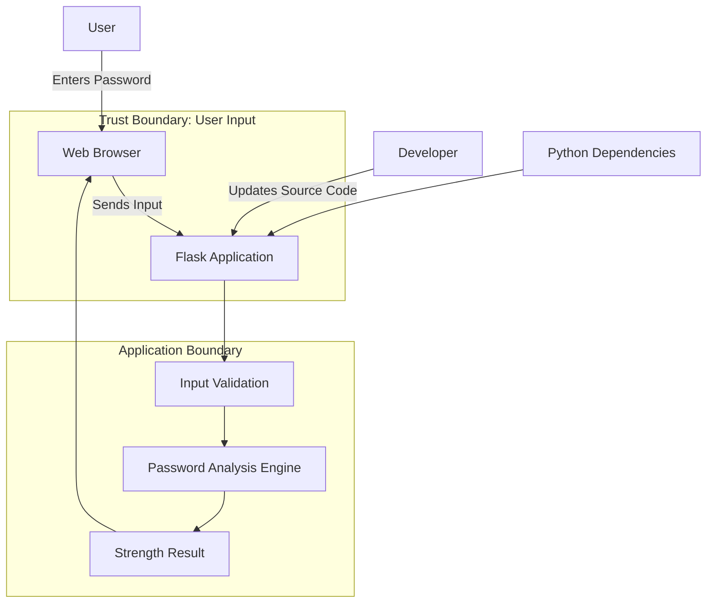

# THREAT MODEL DIAGRAM

## Password Strength Analyzer



## Components

1. User: Enters a password.
2. Web Browser: Sends input to the application.
3. Flask Application: Receives and processes the request.
4. Input Validation: Checks the received input.
5. Password Analysis Engine: Evaluates password strength.
6. Strength Result: Displays the analysis result.
7. Developer: Maintains the application.
8. Python Dependencies: External libraries used by the application.

## Trust Boundaries

- Boundary 1: Between the user's browser and Flask application.
- Boundary 2: Inside the application processing environment.

**Security Note:** User input must always be treated as untrusted data.
```

Save panna **Ctrl + S** press pannu.

Mudichittiya? Next risk register check pannuvom.